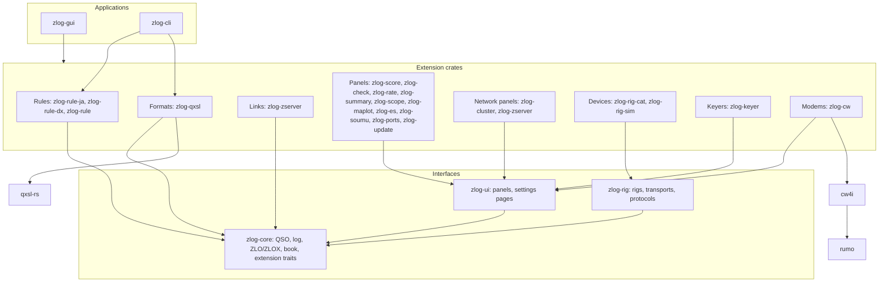
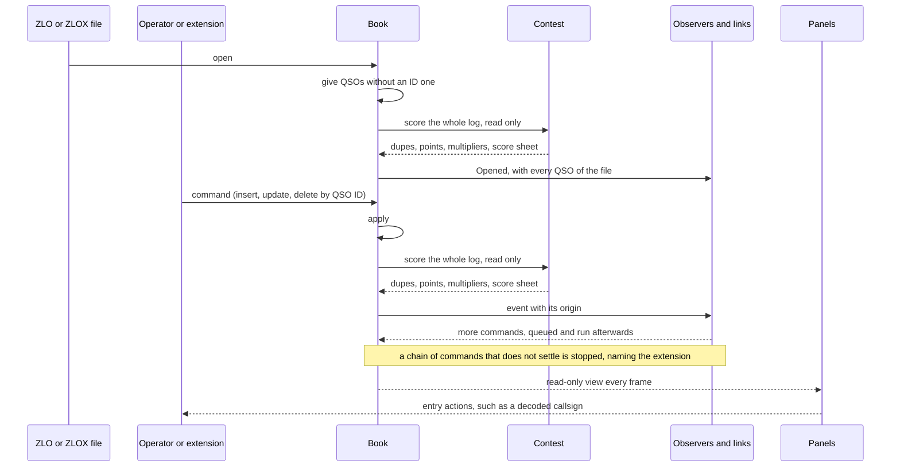
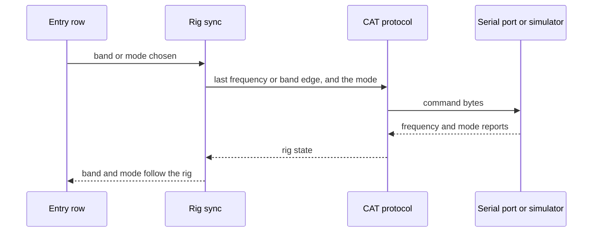

zlog-rs
====


zlog-rs is the contest logger [zLog](https://github.com/jr8ppg/zLog) rewritten in Rust for macOS and Windows.
Its core is small, and every contest, file format, window and device is an extension crate linked in at build time.

## Architecture

The core knows no contest, no screen and no device; everything else is an extension crate, and the application links the ones its build includes.





Rig control keeps the rig and the entry row in step both ways, with the same code for a real rig and the built-in simulator.



## Extensions

| Kind | Trait | Provides |
|---|---|---|
| Rules | `ContestDef`, `Contest` | A contest in the zLog Menu: sent number, number check, scoring, multiplier table. |
| Formats | `LogFormat` | Import and export of a file format, given the log and its contest. |
| Observers | `Observer` | Reactions to changes of the log. |
| Links | `Link` | An observer that also receives from outside, such as a network. |
| Panels | `zlog_ui::Panel` | A window of its own, listed in the menu of its group (Check, Operation, Network, Report, Tools); it may add toolbar buttons (hidden or shown from the Settings menu) and items to the QSO right-click menu, hand spots to other panels and requests to the entry row. |
| Settings | `zlog_ui::SettingsPage` | A page of the Options dialog over the extension's own section. |
| Devices | `zlog_rig::Protocol`, `zlog_rig::Transport` | Rig control. |
| Keyers | `zlog_keyer::Keyer` | CW keying (WinKeyer, DTR/RTS), sending messages on F1 to F12. |
| Modems | `zlog_ui::Panel` | Decoding CW in the CW4ISR window of cw4i. |

An extension crate exports one `Extension` bundling its rules, formats, observers and links, and the application lists the crates it links in `registry.rs`.

Every import and export of a log file goes through zlog-qxsl, the QxSL formats as qxsl-rs writes them (ADIF, Cabrillo, CTESTWIN, HAMLOG, JARL, QXML, zLog text).
zlog-summary makes only the summary sheets: the JARL E-Log summary sheet and the Cabrillo header, with their form, checks and score.
The QSOs of those documents are written by zlog-qxsl (`zlog_qxsl::encode` with the `jarl` and `cqww` formats).
The ZLO and ZLOX files of zlog-core are the program's own log files, not an export format.

Every crate has the same layout, with only the directories it needs:

| Path | Holds |
|---|---|
| `src/` | Rust code only. |
| `data/` | Data embedded in the binary (multiplier lists, tables, maps). |
| `lang/` | User-interface text, `en.lang` and `ja.lang`. |
| `tests/` | Integration tests, and their files in `tests/fixtures/`. |
| `tools/` | Scripts that regenerate `data/`. |
| `LICENSE` | Licence of third-party data in `data/`, where it is not the repository's. |

## Download

Builds of master for macOS and Windows are on the [nightly release](https://github.com/nextzlog/zlog-rs/releases/tag/nightly).

Once installed, zLog updates itself with Help > Update.
It downloads the build of the platform, checks it against the published SHA-256 and replaces the program (on macOS the zLog.app bundle), then offers a restart.
When zLog.app cannot be replaced in place, the disk image is opened in Finder instead.
Local builds report themselves as development builds and are never replaced.
The manual is at [use.zlog.org](https://use.zlog.org), also opened from the Help menu.

## Build

```sh
$ cargo build --release -p zlog-gui
$ ./target/release/zlog-gui
```

Each extension is a Cargo feature of `zlog-gui`, so a build with fewer extensions is chosen with `--no-default-features --features ...`.

## Test

```sh
$ cargo test --workspace
```

## License

### Author

[無線部開発班](https://nextzlog.dev)

### Clauses

- This software is released under the [MIT License](LICENSE).
- Data and code taken from other projects keep their own notices in the crates that use them.
